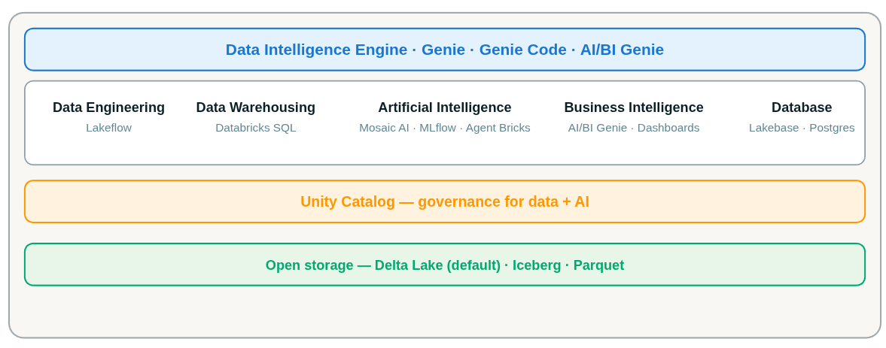
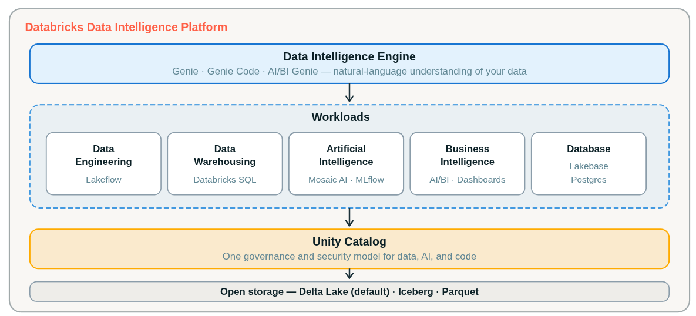
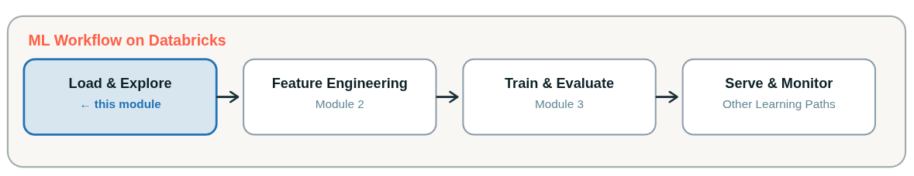
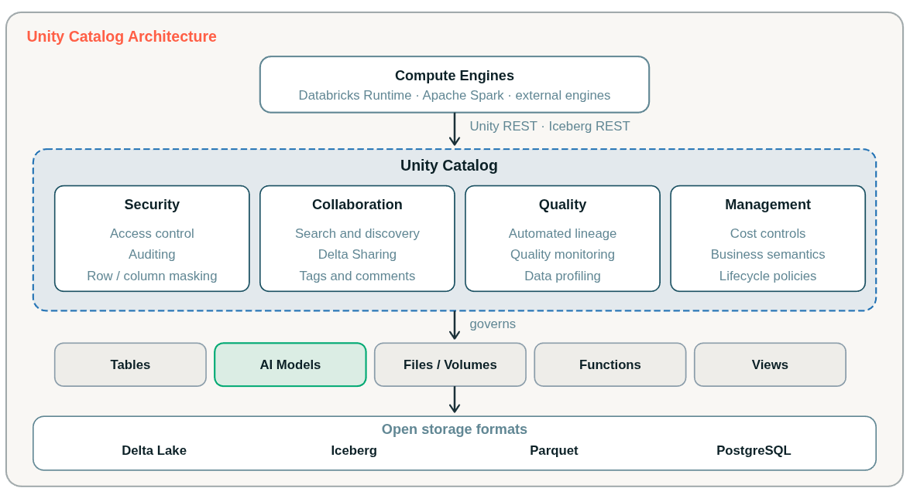
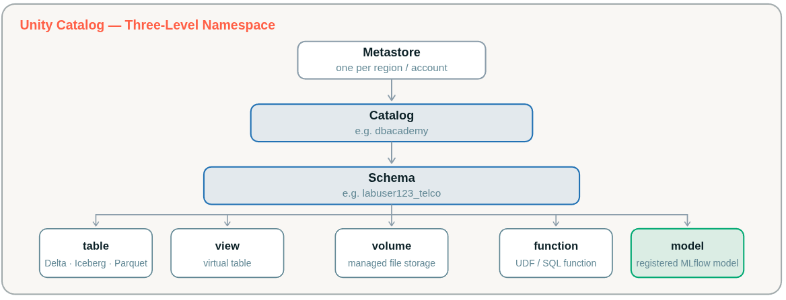
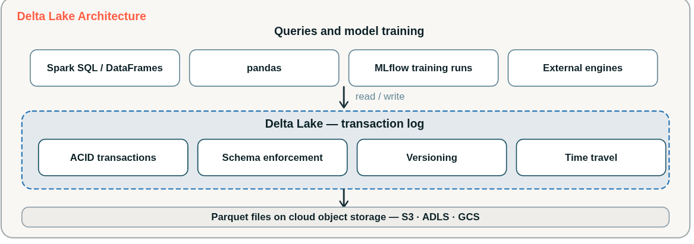
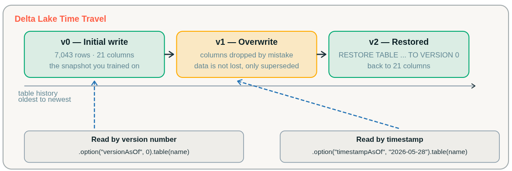

# Managing and Exploring Data

## Overview

This lecture introduces the four platform building blocks used throughout the course.

This lecture covers 4 sections that build on each other:

- **[The Databricks Data Intelligence Platform](#the-databricks-data-intelligence-platform-for-ml)**. The unified lakehouse architecture and its impact on ML workflows
- **[Notebooks for ML Workflows](#notebooks-for-ml-workflows)**. How Databricks notebooks enable exploratory data analysis, collaboration, and reproducibility
- **[Unity Catalog](#unity-catalog)**. The governance model for data, models, and code, including the three-level namespace
- **[Delta Lake for ML](#delta-lake-for-ml)**. Reliable, reproducible storage and time travel for machine learning datasets


## Learning Objectives

By the end of this lecture, you will be able to:

- Identify the four platform building blocks for ML workflows on Databricks and explain their roles
- Use Databricks notebooks (including Genie Code) for fast, collaborative exploratory data analysis
- Describe Unity Catalog's governance model and explain its three-level namespace for organizing assets
- Explain Delta Lake's value for ML, including reliable storage and time travel for reproducible datasets


## The Databricks Data Intelligence Platform for ML

### The Databricks Data Intelligence Platform

The **Databricks Data Intelligence Platform** is built on a *lakehouse* served by a **Data Intelligence Engine** that uses generative AI to understand your data, organized around three properties:

| Property    | What it means                                                |
| ----------- | ------------------------------------------------------------ |
| Intelligent | A Data Intelligence Engine — Genie, Genie Code, AI/BI Genie — that understands your data and lets you work in natural language. |
| Simple      | One platform for data engineering, warehousing, AI, BI, and apps — no separate stacks to integrate. |
| Security    | Unified governance and security (Unity Catalog) over data, AI, and code. |

 [Jump back to the overview](#overview)


### Workloads on the Platform

The platform supports many workload categories on top of a single open storage and governance foundation. The current product navigation on databricks.com lists Data Engineering, Data Warehousing, AI, BI, Database, Application Development, Governance, Sharing, and more.



 [Jump back to the overview](#Overview)


### (2nd verion-Minerva)

 

 [Jump back to the overview](#overview)

### Platform Workloads and Their Relevance to ML

Each workload category has a distinct role in an ML project:

| Workload                    | What it does                                                 | Most relevant to this module?               |
| --------------------------- | ------------------------------------------------------------ | ------------------------------------------- |
| **Data Engineering**        | Data ingestion, ETL, streaming — Lakeflow Connect, Lakeflow Spark Declarative Pipelines, Lakeflow Jobs, Lakeflow Designer | Indirectly — your data arrives via Lakeflow |
| **Data Warehousing**        | SQL analytics — Databricks SQL serverless warehouses         | Sometimes — `%sql` cells in notebooks       |
| **Artificial Intelligence** | Data prep, training, serving, agents — MLflow, Model Serving, Vector Search, Agent Bricks, Databricks Runtime for ML | Yes — this is your home                     |
| **Business Intelligence**   | Dashboards and **AI/BI Genie** (text-to-SQL chat for business users) | No — distinct from **Genie Code**           |
| **Database**                | **Lakebase** — serverless Postgres for applications and AI agents; powers low-latency feature lookups via Synced Tables | Later modules — online feature serving      |


### Where This Module Fits

ML on Databricks spans **data → features → training → serving → governance**. This module covers only the leftmost stages: **loading and exploring data**. Later modules build on this foundation.



## Notebooks for ML Workflows

### Why Databricks Notebooks?

Notebooks are the primary surface for exploratory ML work on Databricks.

| Capability                  | What it means for ML                                         |
| --------------------------- | ------------------------------------------------------------ |
| **Multi-language**          | Mix Python, SQL, Scala, and R in one notebook via `%python`, `%sql`, `%scala`, `%r`. Use SQL for fast aggregations, Python for modeling. |
| **Collaborative**           | Real-time co-editing and comments. Useful for paired EDA with a domain expert. |
| **Reproducible**            | Automatic version history; **Git Folders** for source control. |
| **Built-in visualizations** | `display()` exposes a **Visualization** tab and a **Data Profile** tab without writing plotting code. |
| **AI-assisted authoring**   | **Genie Code** generates, explains, and debugs code from natural-language prompts. |

Useful magic commands you'll see in this module: `%run`, `%pip`, `%sql`, `%md`, `%sh`, `%fs`.

 [Jump back to the overview](#overview)


### Quick Exploratory Data Analysis

Two clicks worth of EDA you'll use constantly:

- **Data Profile** — summarizes each column (count, distinct, nulls, min/max, histograms)
- **Visualization** — interactive charts directly from a DataFrame

Both are exposed by `display(df)`. The next few cells run the pattern on the telco dataset the demo and lab will use.

### Read the CSV file into a Spark DataFrame

```python
dataset_path = "../telco-customer-churn.csv"

telco_df = spark.read.csv(dataset_path, header="true", inferSchema="true", multiLine="true", escape='"')
print(f"Rows: {telco_df.count():,}   Columns: {len(telco_df.columns)}")
```

The output from the code is:

Rows: 7,043 Columns: 21

### Display the DataFrame

Use the **`display()`** function on the DataFrame to view the table. Click the "+" icon above the output to add a visualization.

```python
display(telco_df)
```


**Table**+

| Index | customerID | gender | SeniorCitizen | Partner | Dependents | tenure |
| :---- | :--------- | :----- | :------------ | :------ | :--------- | :----- |
| 1     | 7590-VHVEG | Female | 0             | No      | No         | 1      |
| 2     | 5575-GNVDE | Male   | 0             | No      | No         | 34     |
| 3     | 3668-QPYBK | Male   | 0             | Yes     | No         | 2      |

 [Jump back to the overview](#overview)


### Multi-Language Notebooks in Practice

The code below demonstrates how to use SQL to quickly aggregate and summarize the Churn class distribution from the telco dataset.

1. We first register the DataFrame as a temporary view.

```python
    telco_df.createOrReplaceTempView("telco_view")
```

1. Then run a SQL query to count the number of customers in each Churn category.

```sql
%sql
SELECT Churn, COUNT(*) AS n
FROM telco_view
GROUP BY Churn
ORDER BY n DESC;
```


**Table**+

| Index | Churn | n     |
| :---- | :---- | :---- |
| 1     | No    | 5,174 |
| 2     | Yes   | 1,869 |

### Genie Code for ML EDA

**Genie Code** is the AI authoring assistant available in the notebook side panel. For ML EDA, it can generate visualization and analysis code from natural language — no need to remember matplotlib or seaborn syntax.

A good Genie Code prompt for EDA includes the following:

- The DataFrame to use (e.g., `telco_df`)
- The target variable (e.g., `Churn`)
- The analyses to run (class balance, missing values, feature-vs-target comparisons)
- The libraries to use (matplotlib / seaborn)

**Example prompt:**

```
Using the Spark DataFrame `telco_df`, convert it to pandas and perform EDA as follows:
1. Plot a bar chart showing the count and percentage of each class in the `Churn` column.
2. Plot a horizontal bar chart showing the percentage of missing values for each column.
3. Use matplotlib for all visualizations. 
4. Add clear titles, axis labels, and display value annotations where helpful.
5. Briefly describe any insights from the plots in comments.
```

 [Jump back to the overview](#overview)


## Unity Catalog

### The Unity Catalog Architecture

- Unity Catalog sits between the **compute engine** you use to query data and the **open storage formats** your data is written in.
- Compute engines (Databricks Runtime, Spark, and others) talk to UC over the **Unity REST** and **Iceberg REST** APIs.
- UC governs data and AI assets such as tables, volumes/files, functions, and models across open formats (Delta Lake, Iceberg, Parquet), and also provides discovery and lineage across related assets such as notebooks, jobs, and dashboards.




**Note**

* Unity Catalog applies governance, permissions, lineage, and audit once at the catalog layer. Any compute engine accessing data through UC inherits these controls automatically, ensuring consistent security and discoverability across all workloads.


 [Jump back to the overview](#overview)


### What Unity Catalog Governs

For ML projects, this means training data, feature tables, and models can share a unified governance model in UC, while related assets such as notebooks and dashboards can still appear in lineage and discovery experiences.

| Object type                 | Examples                                                     |
| :-------------------------- | :----------------------------------------------------------- |
| **Tables**                  | Delta · Iceberg · Parquet (Lakehouse Federation: external warehouses too) |
| **Volumes**                 | Managed storage for unstructured / non-tabular data          |
| **Models**                  | **Models in Unity Catalog** (replaces "Model Registry")      |
| **Views**                   | Logical datasets defined in SQL                              |
| **Functions**               | SQL UDFs and AI functions                                    |
| **Lineage-covered assets**  | Notebooks, jobs, dashboards, and models that UC can connect through lineage |
| **External access objects** | Connections, shares, and other governed integration points   |

 [Jump back to the overview](#overview)


### Why Governance Matters for ML

ML projects touch many asset types: training data, feature tables, notebooks, models, dashboards, and increasingly AI agents and MCP servers. Without unified governance you end up answering the same questions for each system separately:

*"Where do I find the dataset? Can I trust it? Who's allowed to read it? Who already accessed it? Are we compliant?"*

**Unity Catalog (UC)** is Databricks' single permission model for data **and** AI. It governs:

| Object type     | Examples                                                     |
| :-------------- | :----------------------------------------------------------- |
| **Tables**      | Delta · Iceberg · Parquet (Lakehouse Federation: external warehouses too) |
| **Files**       | **Volumes** for unstructured / non-tabular data              |
| **Models**      | **Models in Unity Catalog** (replaces "Model Registry")      |
| **Notebooks**   | Workspace assets                                             |
| **Dashboards**  | AI/BI Dashboards                                             |
| **AI Agents**   | Agent Bricks artifacts                                       |
| **MCP servers** | Governed via **Unity AI Gateway**                            |

 [Jump back to the overview](#overview)


### The Three-Level Namespace

Every object in UC is addressed as `catalog.schema.object`. The hierarchy below shows how assets are organized.



When you call `saveAsTable("telco_missing_bronze")` without qualifying the name, it lands in your **current catalog and schema** — which the classroom setup configured for you. You can run the following code with **`%sql`** magic command to confirm your current context.

```sql
%sql
SELECT current_catalog() AS catalog, current_schema() AS schema;
```

 [Jump back to the overview](#overview)

### Permissions on a Delta Table

UC permissions use standard SQL `GRANT` / `REVOKE`. Common privileges for ML data:

| Privilege            | Use case                            |
| :------------------- | :---------------------------------- |
| **`SELECT`**         | Read the table (e.g., for training) |
| **`MODIFY`**         | Write / update rows                 |
| **`ALL PRIVILEGES`** | Full control                        |

The example below is illustrative — do not run it against tables you don't own:

```sql
GRANT SELECT
  ON TABLE <catalog>.<schema>.telco_missing_bronze
  TO `account users`;
```

 [Jump back to the overview](#overview)


## Delta Lake for ML

### What Delta Lake Is and the Features You Will Use

**Delta Lake** is the open-source storage format that is the **default** for tables on Databricks. It is the layer that makes a data lake reliable enough to use as a *system of record* — including for ML training data.



The following features are used in this module's demo and lab:

| Feature                                    | Where you will see it                                        |
| :----------------------------------------- | :----------------------------------------------------------- |
| **ACID transactions**                      | Safe concurrent writes (atomicity, consistency, isolation, durability) |
| **Default format on `saveAsTable`**        | Writing the bronze table                                     |
| **Schema enforcement + `overwriteSchema`** | Replacing a table whose schema changed                       |
| **`DESCRIBE HISTORY`**                     | Inspecting versions                                          |
| **`versionAsOf` / `timestampAsOf`**        | Time-travel reads                                            |
| **Multi-language access**                  | %sql and Python on the same table                            |


<details>
  <summary><b>Delta Lake: Advanced Features</b></summary>

- **Liquid Clustering** — replaces static partitioning and ZORDER. Self-tuning and skew-resistant: only rewrites the data that needs reorganization, and clustering keys can be changed at any time without rewriting the full table. Recommended for all new Delta tables (DBR 15.2+). Use `CLUSTER BY AUTO` to let Databricks pick keys automatically (DBR 15.4+).
- **Predictive Optimization** — automatically runs OPTIMIZE and VACUUM on Unity Catalog managed tables based on observed query patterns across the platform. No manual maintenance scheduling needed. Requires the Premium plan and UC managed tables.
- **Change Data Feed** — when enabled, records every row-level insert, update, and delete between table versions. Ideal for incremental ETL (process only changed rows), audit trails, and syncing changes to downstream tables or external systems. Read changes with `table_changes()` or `.option("readChangeFeed", True)`.
- **MERGE** — SQL upsert that matches source rows against the target on a join key, then updates matched rows and inserts new ones. Supports `WHEN NOT MATCHED BY SOURCE` for soft-deletes, and handles deduplication in ETL pipelines.

</details>

 [Jump back to the overview](#overview)

### Writing a Delta Table

`saveAsTable(...)` writes Delta by default and registers the table in your current UC catalog and schema. Two write options are worth knowing:

- `mode("overwrite")` — replaces the table if it exists, making reruns idempotent
- `option("overwriteSchema", "true")` — allows the new write to redefine column types (Delta options accept strings or booleans; the docs use `"true"` as a string)

```python
full_table_path = "catalog.schema.table_name"

# Write using the explicit path
(
    telco_df.write
        .mode("overwrite")
        .option("overwriteSchema", "true")  # Delta options accept strings or booleans
        .saveAsTable(full_table_path)
)

print(f"Wrote Delta table: {full_table_path}")
```

 [Jump back to the overview](#overview)

### Time Travel in Practice

Every write to a Delta table creates a new **version**. `DESCRIBE HISTORY` lists all versions; reads can specify any prior version by number or timestamp. This is the mechanism that makes training data **reproducible** — if you trained a model on Monday's snapshot and want to retrain on exactly the same input two weeks later, you can.




> **Info**
>
> **Time travel tip:** When you use `timestampAsOf` to read a Delta table, Databricks returns the version that was current at that exact moment. This is especially useful if you know the date and time of a training run, but not the version number. Use `timestampAsOf` for reproducibility when tracking ML experiments by timestamp.
>
> 


`DESCRIBE HISTORY` returns one row per version. The table below shows a representative sample of the columns:

| version | timestamp           | operation | operationParameters                     |
| :------ | :------------------ | :-------- | :-------------------------------------- |
| 1       | 2026-05-28 14:02:11 | WRITE     | {"mode":"Overwrite","partitionBy":"[]"} |
| 0       | 2026-05-28 13:58:44 | WRITE     | {"mode":"Overwrite","partitionBy":"[]"} |

To read a specific version by number or by timestamp:

```python
# Read version 0 — the very first write of the table
telco_v0 = (
    spark.read
        .option("versionAsOf", 0)
        .table("lecture_telco_demo")
)

print(f"Version 0 rows: {telco_v0.count():,}   Columns: {len(telco_v0.columns)}")
# Output: Version 0 rows: 7,043   Columns: 21
```

 [Jump back to the overview](#overview)

## Conclusion

In this lecture, you covered the four platform building blocks that underpin every demo and lab in this module:

1. **Databricks Data Intelligence Platform** — a unified lakehouse with a Data Intelligence Engine, open formats, and a single governance layer for all ML assets.
2. **Databricks Notebooks** — multi-language, collaborative, and AI-assisted via Genie Code; `display()` and `summary()` are your fastest EDA tools.
3. **Unity Catalog** — a three-level namespace (`catalog.schema.object`) with SQL-based permissions, automated lineage, and governance for tables, volumes, models, and AI agents.
4. **Delta Lake** — the default table format on Databricks; ACID transactions, schema enforcement, and time travel make training data reliable and reproducible.

 [Jump back to the overview](#overview)
