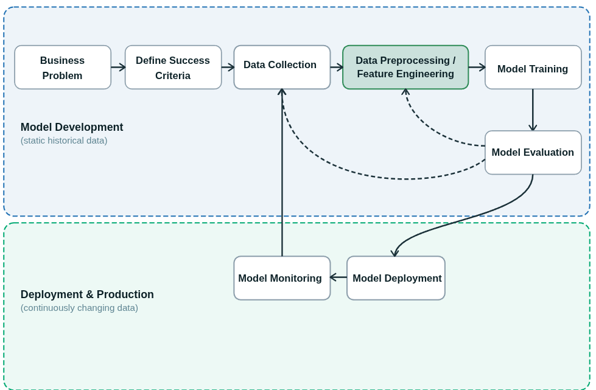

# Lecture — Fundamentals of Data Preparation and Feature Engineering

## Overview

This lecture covers the following four conceptual foundations that build on each other:

- **A. The Data Preparation Workflow**. Where data prep sits in the ML lifecycle, the difference between cleaning and feature engineering
- **B. Feature Engineering and Feature Selection**. Transforming raw data into informative features and selectively removing noise
- **C. Splitting Data**. Train/validation/test splits, cross-validation, and avoiding data leakage
- **D. Sampling Methods**. Random, stratified, and cluster sampling in PySpark

## Learning Objectives

By the end of this lecture, you will be able to:

- Describe where data preparation sits in the ML lifecycle and why it dominates project time
- Distinguish cleaning and formatting from feature engineering and feature selection
- Choose an appropriate train/validation/test split strategy and apply cross-validation
- Apply random, stratified, and cluster sampling in PySpark

## The Data Preparation Workflow

### Where Data Prep Sits in the Machine Learning Lifecycle

The Machine Learning lifecycle divides into two broad phases: **model development** and **production**.

Practitioners commonly report that **60–80% of project time** is spent on data preparation. Time invested here translates directly into model quality.

### The Machine Learning Full Lifecycle

Building a model is only one stage in a larger workflow. The full lifecycle spans from defining the business problem through deployment and ongoing monitoring.

| Stage                           | Phase       | Description                                                  |
| :------------------------------ | :---------- | :----------------------------------------------------------- |
| Business Problem                | Development | Define the business objective and frame it as a machine learning problem. |
| Define Success Criteria         | Development | Establish measurable goals such as accuracy, latency, or revenue impact to determine whether the model meets business needs. |
| Data Collection & Preprocessing | Development | Gather, clean, and transform relevant data into features suitable for model training. |
| Model Training                  | Development | Train candidate models on historical data, iterating on algorithms and hyperparameters to optimize performance. |
| Model Evaluation                | Development | Assess model performance on held-out data and compare experiments to select the best candidate. |
| Model Deployment                | Production  | Package and serve the selected model in a production environment to generate predictions on continuously arriving new data. |
| Model Monitoring                | Production  | Track model performance on live data, detect drift or degradation, and feed insights back into retraining. |

### Data Preparation

ata preparation encompasses two distinct categories of work. Understanding the difference helps you sequence your pipeline correctly.

| Category                  | Goal                                      | Typical Operations                                           |
| :------------------------ | :---------------------------------------- | :----------------------------------------------------------- |
| **Cleaning & formatting** | Make the data *correct and usable*        | Fix data types, remove outliers, drop empty columns/rows, impute missing values, deduplicate |
| **Feature engineering**   | Make the data *informative for the model* | Numerical transforms (log, normalize), aggregations, encoding categoricals, generating new features, embedding text/images |

The same dataset usually requires both — and the order matters. **Clean first**, then **engineer**, then **split**, and always **fit transformations on the training set only**.

## Feature Engineering and Feature Selection

### Feature Engineering

**Feature engineering** transforms raw data into a format that lets ML models extract patterns. The goal is not *more* features — it is *more informative* features.

Common operations include:

- **Numerical transforms** — log, standardize, bin
- **Encoding categoricals** — one-hot, label, target, embedding
- **Aggregations** — rolling means, group counts, recency
- **Derived features** — ratios, differences, interactions
- **Text / image / audio** — TF-IDF, embeddings, pretrained model outputs

#### Feature Extraction

A specialized case of feature engineering: derive a *smaller* set of features that better represent the underlying patterns. Examples include PCA, autoencoders, and learned embeddings.

### Feature Selection: Dropping Columns and Rows

Feature selection is the mirror of engineering — selectively *remove* features (columns) or instances (rows) to streamline the dataset and reduce noise.

**Reasons to drop columns:**

- High percentage of missing values
- Irrelevant or redundant features (high correlation with another column)
- Computational efficiency

**Reasons to drop rows:**

- Too many missing fields per row
- Outliers that reflect data-quality issues, not signal

## Splitting Data

### Why We Split

A model cannot be evaluated on the same data it was trained on — it would memorize rather than generalize. Splitting the dataset solves four interconnected problems:

| Need                      | What Splitting Gives You                                     |
| :------------------------ | :----------------------------------------------------------- |
| **Avoid overfitting**     | A held-out test set the model never saw during training      |
| **Hyperparameter tuning** | A validation set you can iterate on without leaking the test set |
| **Prevent data leakage**  | Transformations fit on the training set only, then applied to validation/test |
| **Honest evaluation**     | A final test score that estimates real-world performance     |

### Train / Validation / Test

The two most common split structures are shown below. The demos in this module use the simple 80/20 split.

## Conclusion

In this lecture, you covered the conceptual foundations that underpin every demo and lab in this module:

1. **The Data Preparation Workflow** — data preparation (cleaning, engineering, and splitting) typically accounts for 60–80% of total project time and directly determines model quality.
2. **Feature Engineering and Selection** — cleaning (making data correct and usable) must precede feature engineering (making data informative); selectively removing noisy features reduces overfitting.
3. **Splitting Data** — transformations must be fit on the training set only, then applied to validation and test sets to prevent data leakage; cross-validation provides more reliable estimates when dataset size is limited.
4. **Sampling Methods** — PySpark provides `randomSplit`, `sample`, and `sampleBy` for splitting and sampling at scale.

Together, these concepts form the foundation for robust, reproducible data preparation pipelines on Databricks — making it straightforward to clean, transform, split, and sample data before model training.